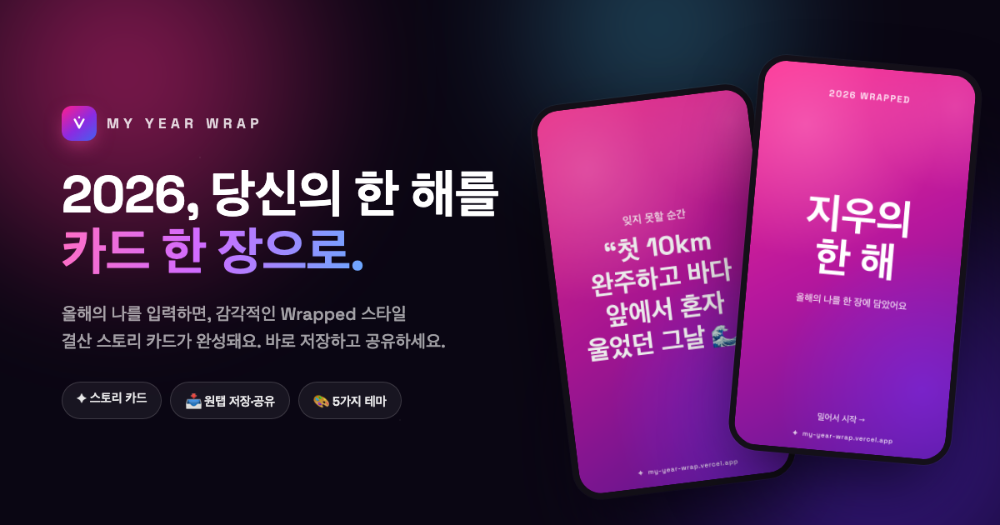
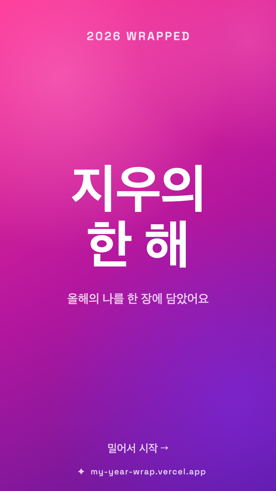
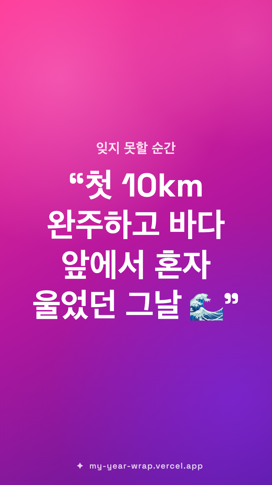
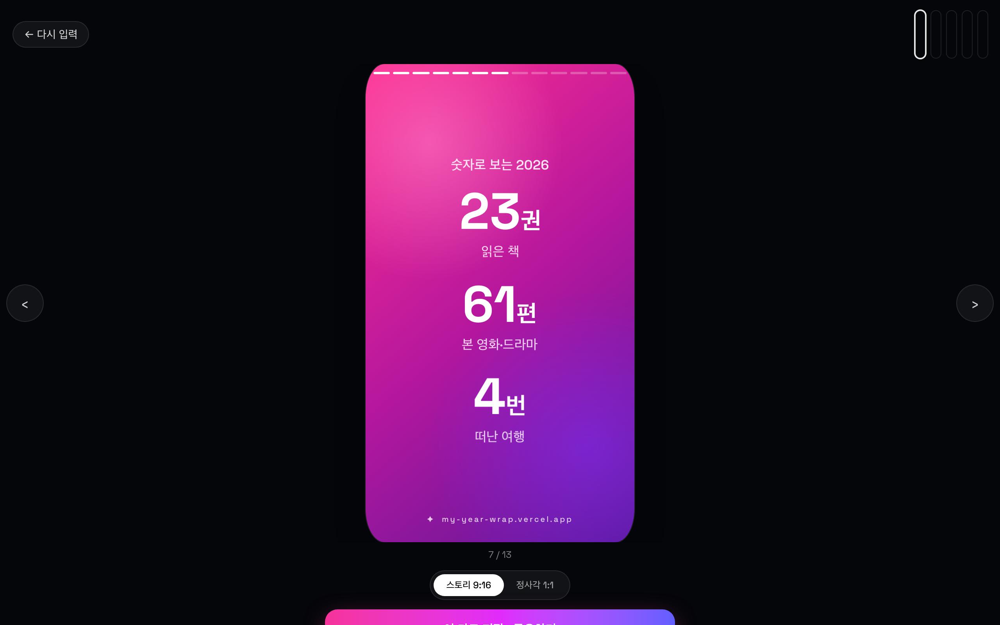

# My Year Wrap · 2026 나의 한 해 결산 카드

> 올해의 나를 입력하면, Spotify Wrapped 스타일의 **감각적인 결산 스토리 카드**를 만들어 드려요.
> 스토리로 넘겨 보고, 1080×1920 이미지로 저장해 SNS에 공유하세요. 🎁

<p>
  
  
  
  
  
</p>

## 🔗 라이브 데모

**https://my-year-wrap.vercel.app**

---

## ✨ 주요 기능

- 📝 **유연한 입력** — 올해의 단어, 노래/영화/책, 읽은 책·본 영화·여행 횟수, 잊지 못할 순간, 내년 다짐까지. **채우고 싶은 항목만** 적으면 되고, 빈 칸은 카드에서 자연스럽게 빠져요.
- 🎞️ **Wrapped 스타일 스토리** — 표지 → 올해의 단어 → 컬렉션 → 숫자 요약 → 순간 → 다짐 → 마무리까지, 세로 슬라이드를 스와이프·화살표·키보드로 넘겨 봅니다. 등장 애니메이션은 덤.
- 🎨 **5가지 그라데이션 테마** — 네온 선셋 · 오로라 · 라임 팝 · 선셋 탠저린 · 미드나잇 그레이프. 고르는 즉시 모든 슬라이드에 반영돼요.
- 📥 **원탭 저장 · 공유** — 지금 보고 있는 슬라이드를 **1080×1920(스토리)** 또는 **1080×1080(정사각)** 이미지로 생성. 모바일에서는 Web Share, 데스크탑에서는 다운로드. 한글·이모지·긴 문장도 자동 줄바꿈/축소로 깔끔하게.
- 💾 **자동 저장** — 입력값과 테마는 localStorage에 저장돼 다시 방문해도 그대로. 서버·API 없이 100% 프론트엔드로 동작합니다.

## 🖼️ 공유 카드 미리보기

실제로 저장되는 1080×1920 스토리 카드 예시 — 긴 문장과 이모지(🌊)도 넘침 없이 렌더됩니다.

<p>
  
  
</p>

## 🛠️ 기술 스택

- **React 19 + TypeScript**
- **Vite** (빌드/번들)
- **Tailwind CSS v4** (`@tailwindcss/vite` 플러그인 방식)
- **Canvas 2D API** — 공유 이미지 생성 (웹폰트 로드 보장 후 그리기, 텍스트 자동 맞춤 + 줄바꿈)
- 영속화: **localStorage** · 배포: **Vercel**

## 🚀 로컬 실행

```bash
npm install
npm run dev
```

빌드:

```bash
npm run build
npm run preview
```

## 📱 사용 방법

1. 테마를 고르고, 올해의 나를 자유롭게 입력해요. (하나도 안 적고 바로 만들면 샘플 카드를 보여줘요)
2. **카드 만들기**를 누르면 스토리 뷰어로 이동합니다.
3. 탭/스와이프/화살표로 슬라이드를 넘겨 보고, 마음에 드는 장면에서 **이 카드 저장 · 공유하기**를 누르세요.

---



<p align="center"><sub>Made with ✦ for everyone wrapping up their 2026.</sub></p>
